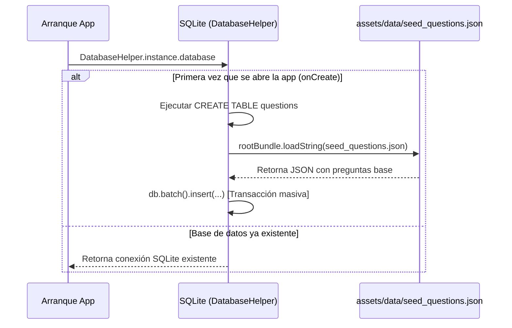

# Arquitectura, Esquema de Datos y Lógica de Evaluación

---

## 1. Arquitectura del Sistema

El proyecto sigue una arquitectura desacoplada basada en capas, manteniendo independencia entre la fuente de datos, las reglas de negocio/estado y la interfaz gráfica:

```
┌────────────────────────────────────────────────────────┐
│                   Capa de Presentación                 │
│  - Screens: HomeTabletScreen, ExamScreen, ResultsScreen │
│  - Widgets: QuestionCard, NavigatorGrid               │
│  - Theme: AppTheme (Light & Dark Tablet Palette)       │
└───────────────────────────┬────────────────────────────┘
                            │ (Escucha y emite estados)
┌───────────────────────────▼────────────────────────────┐
│              Capa de Negocio / Estado                  │
│  - ExamController (ChangeNotifier / Provider)          │
│    * Gestión de temporizadores y sesiones             │
│    * Registro de respuestas y cálculo fórmula UNED     │
└───────────────────────────┬────────────────────────────┘
                            │ (Llama a fuentes locales)
┌───────────────────────────▼────────────────────────────┐
│                    Capa de Datos                       │
│  - Model: Question                                     │
│  - Datasource: DatabaseHelper (SQLite con sqflite)     │
│  - Assets: seed_questions.json                         │
└────────────────────────────────────────────────────────┘
```

---

## 2. Esquema Relacional de Base de Datos (SQLite)

La persistencia local se gestiona con **SQLite** a través del plugin `sqflite`. La base de datos reside en el almacenamiento interno privado de la aplicación (`uned_infantil.db`).

### Definición DDL de la Tabla `questions`
```sql
CREATE TABLE questions (
  id INTEGER PRIMARY KEY AUTOINCREMENT,
  subject TEXT NOT NULL,           -- Asignatura o módulo de grado
  topic TEXT NOT NULL,             -- Tema específico dentro de la asignatura
  question TEXT NOT NULL,          -- Enunciado completo de la pregunta
  options TEXT NOT NULL,           -- Lista de opciones serializada en JSON
  correct_index INTEGER NOT NULL,  -- Índice base 0 de la alternativa correcta
  explanation TEXT NOT NULL,       -- Justificación y referencia bibliográfica
  is_favorite INTEGER DEFAULT 0,   -- Bandera booleana (1 = favorita/dudosa, 0 = no)
  times_answered INTEGER DEFAULT 0,-- Contador acumulado de intentos
  times_failed INTEGER DEFAULT 0   -- Contador acumulado de respuestas erróneas
);
```

### Índices y Optimización
Para consultas de filtrado rápido en tablets con miles de preguntas, se pueden emplear índices sobre `subject` y `times_failed`:
```sql
CREATE INDEX idx_questions_subject ON questions(subject);
CREATE INDEX idx_questions_failed ON questions(times_failed);
```

---

## 3. Flujo de Precarga e Importación (*Seed Data*)



### Importación Dinámica desde la App
En la pestaña **Importar / Datos** de la aplicación, el usuario puede pegar un bloque JSON o cargar paquetes de preguntas adicionales sin necesidad de recompilar la aplicación.

---

## 4. Algoritmo de Calificación y Penalización Oficial de la UNED

En los exámenes de la UNED, la nota final se calcula para evitar que responder al azar beneficie la puntuación final. 

### Fórmula General
$$\text{Nota} = \max\left(0, \frac{\text{Aciertos} - \frac{\text{Errores}}{k-1}}{\text{Total de Preguntas}} \times 10\right)$$

Donde:
- $k$: Número de alternativas u opciones por pregunta.
- **En blanco**: Las preguntas sin contestar no suman ni restan ($0$ puntos).

### Casos de Estudio en Educación Infantil:
1. **Preguntas con 3 alternativas ($k=3$)**:
   $$\text{Penalización por fallo} = \frac{1}{3-1} = 0.50 \text{ aciertos netos}$$
   *Por cada 2 fallos, se anula 1 acierto.*
2. **Preguntas con 4 alternativas ($k=4$)**:
   $$\text{Penalización por fallo} = \frac{1}{4-1} = 0.33 \text{ aciertos netos}$$
   *Por cada 3 fallos, se anula 1 acierto.*

### Implementación en Código (`ExamController`):
```dart
double get scoreOver10 {
  if (_questions.isEmpty) return 0.0;
  double netPoints = 0.0;
  for (int i = 0; i < _questions.length; i++) {
    if (!_userAnswers.containsKey(i)) continue; // En blanco
    final q = _questions[i];
    final k = q.options.length > 1 ? q.options.length : 3;
    final penaltyFactor = 1.0 / (k - 1);

    if (_userAnswers[i] == q.correctIndex) {
      netPoints += 1.0;
    } else {
      netPoints -= penaltyFactor;
    }
  }
  if (netPoints < 0) netPoints = 0.0;
  return double.parse(((netPoints / _questions.length) * 10).toStringAsFixed(2));
}
```
